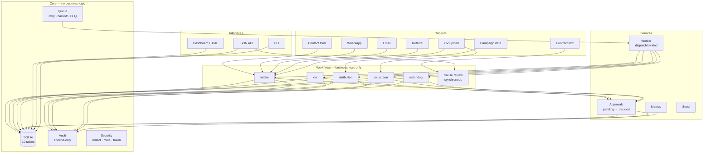
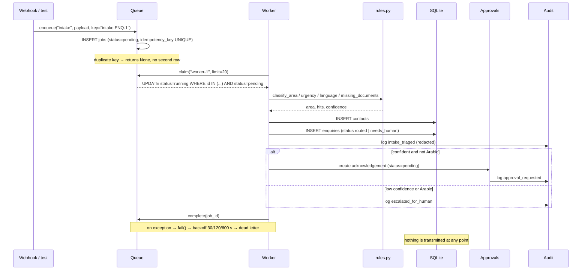
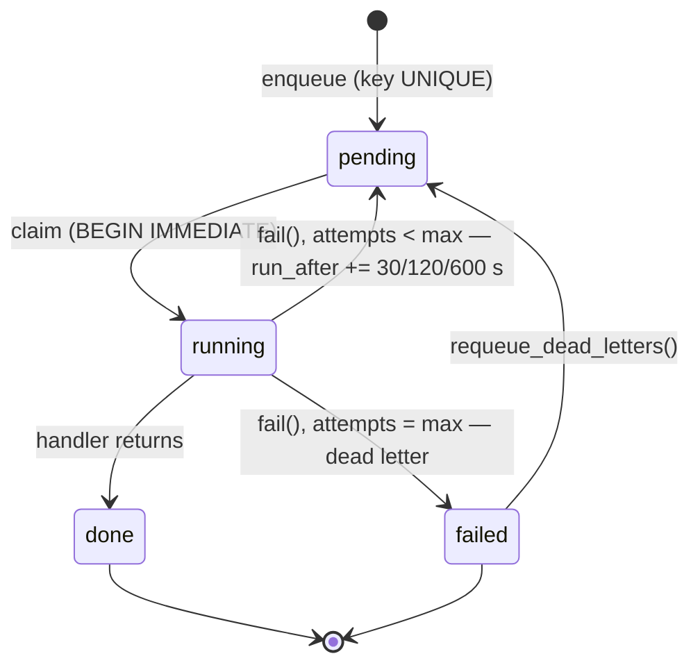
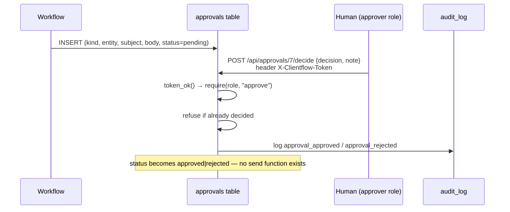
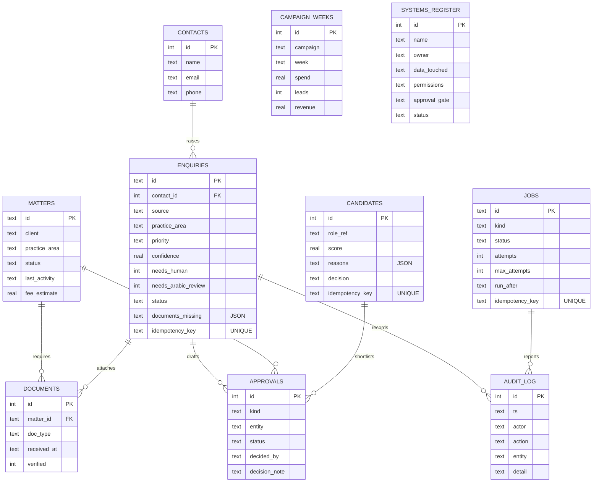
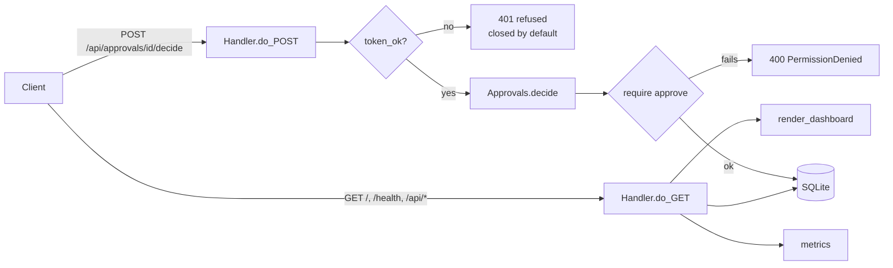

# Architecture

## 1. System diagram

## 2. Request lifecycle — an enquiry, end to end

## 3. Queue and retry state machine

Failure semantics worth saying out loud: retries are **unconditional**. Idempotency is enforced per handler
via keys, not by the queue, which is why every handler writes with an `idempotency_key` or checks existence
first.

## 4. Approval gate

## 5. Entity relationship diagram

## 6. API architecture

| Method | Path | Purpose | Auth |
|---|---|---|---|
| GET | `/` | dashboard, optional `?review=N&compare=1` | none (localhost) |
| GET | `/health` | liveness + schema version | none |
| GET | `/api/stats` | overview, hours saved, findings | none |
| GET | `/api/enquiries` | enquiry list | none |
| GET | `/api/approvals` | pending approvals | none |
| GET | `/api/jobs` | queue health | none |
| GET | `/api/register` | systems register | none |
| GET | `/api/attribution` | campaign spend vs revenue | none |
| GET | `/api/review` | clause review (`?idx=` or `?text=`) | none |
| POST | `/api/approvals/<id>/decide` | record decision | **token** |

Read endpoints are unauthenticated because the server binds to `127.0.0.1`. That is a deliberate bound, not
an oversight — and it is the first thing to change before deploying.

## 7. Why the boundaries are where they are

- **Workflows know business rules, never retries, never HTTP.** A new automation is ~80 lines and inherits
  the queue, audit and approval behaviour for free.
- **Core knows nothing about law, CVs or campaigns.** It could run any group's processes.
- **Services hold the policy** (who may approve, how hours are estimated, what seed data looks like).
- **Interfaces are thin** — the dashboard renders from the same functions the API returns, so a number
  cannot differ between the two.
